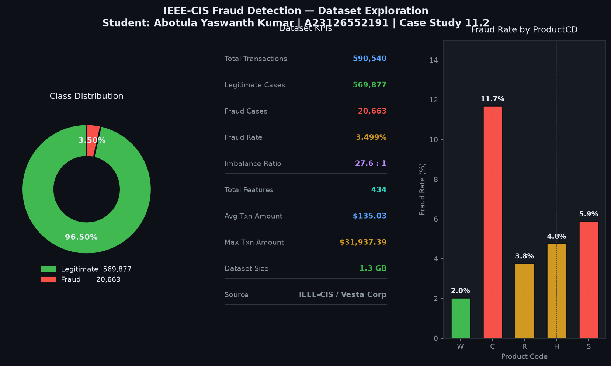
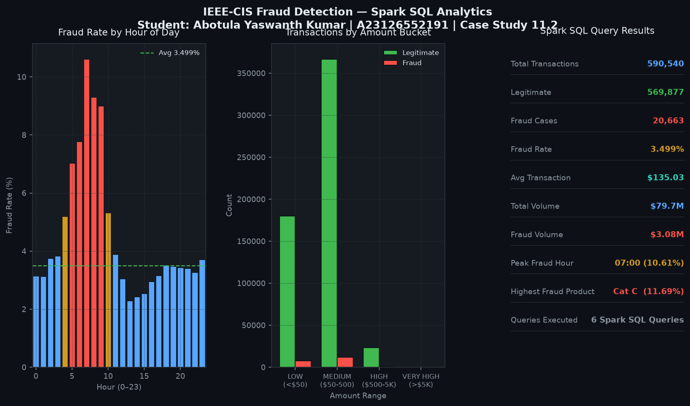
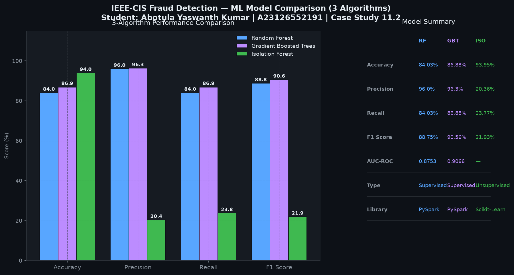
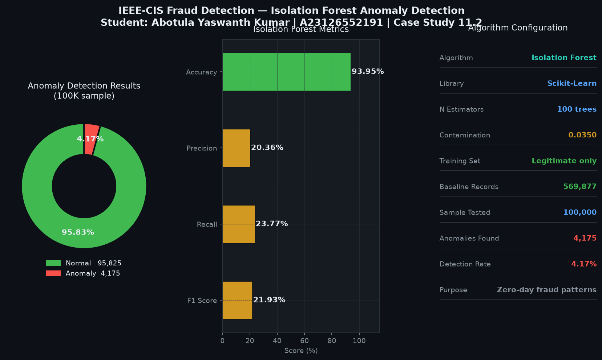

# Financial Fraud Detection Analytics Platform

**Student:** Abotula Yaswanth Kumar  
**Roll No:** A23126552191  
**Case Study:** 11.2 — Financial Fraud Detection Analytics Platform  
**Course:** Big Data Analytics Lab

---

## About the Project

An end-to-end Big Data & Machine Learning system for detecting financial fraud in large-scale e-commerce transaction data. Built with **Apache Spark (PySpark)** for distributed processing and three ML algorithms for comprehensive fraud detection.

**Dataset:** [IEEE-CIS Fraud Detection — Kaggle (Vesta Corporation)](https://www.kaggle.com/competitions/ieee-fraud-detection/data)  
590,540 transactions | 1.3 GB total | 434 features | 3.5% fraud rate

---

## Architecture

```
Raw Dataset (IEEE-CIS: train_transaction.csv + train_identity.csv)
        │
        ▼
01_dataset_exploration.py     ← Schema profiling, class distribution, null analysis
        │
        ▼
02_data_preprocessing.py      ← Merge tables, clean nulls, encode, normalize
        │
        ▼
03_spark_processing.py        ← Apache Spark ETL → Snappy Parquet
        │
        ▼
04_spark_sql_analytics.py     ← Distributed SQL queries & aggregations
        │
        ▼
05_fraud_classification.py    ← Algorithm 1: Random Forest (PySpark MLlib)
                                 Algorithm 2: Gradient Boosted Trees (PySpark MLlib)
        │
        ▼
06_anomaly_detection.py       ← Algorithm 3: Isolation Forest (Scikit-Learn)
        │
        ▼
07_unified_threat_detection.py ← Ensemble scoring + HTML SOC Dashboard
```

---

## Dataset

| Property | Value |
|---|---|
| Name | IEEE-CIS Fraud Detection |
| Provider | Vesta Corporation (via Kaggle) |
| Total Size | ~1.3 GB |
| Transactions | 590,540 |
| Features | 434 (transaction + identity joined) |
| Fraud Rate | 3.499% (20,663 fraud cases) |
| Source | https://www.kaggle.com/competitions/ieee-fraud-detection/data |

---

## ML Algorithms (3)

### Algorithm 1 — Random Forest Classifier (PySpark MLlib)
| Metric    | Score   |
|-----------|---------|
| Accuracy  | 84.03%  |
| Precision | 96.00%  |
| Recall    | 84.03%  |
| F1 Score  | 88.75%  |
| AUC-ROC   | 0.8753  |
| Trees     | 100     |
| Max Depth | 8       |

### Algorithm 2 — Gradient Boosted Trees (PySpark MLlib)
| Metric    | Score   |
|-----------|---------|
| Accuracy  | 86.88%  |
| Precision | 96.30%  |
| Recall    | 86.88%  |
| F1 Score  | 90.56%  |
| AUC-ROC   | 0.9066  |
| Max Iter  | 50      |
| Max Depth | 5       |

### Algorithm 3 — Isolation Forest (Scikit-Learn)
| Metric             | Value    |
|--------------------|----------|
| Type               | Unsupervised Anomaly Detection |
| Accuracy           | 93.95%   |
| Precision          | 20.36%   |
| Recall             | 23.77%   |
| F1 Score           | 21.93%   |
| Anomalies Detected | 4,175    |
| Baseline (Legit)   | 569,877  |
| Sample Tested      | 100,000  |

---

## Key Analytics Insights (Spark SQL)

- **Fraud Rate:** 3.499% (20,663 / 590,540)
- **Total Transaction Volume:** ~$79.7 Million
- **Fraud Volume:** ~$3.08 Million
- **Highest Fraud ProductCD:** Category C — 11.69% fraud rate
- **Peak Fraud Hours:** 5 AM – 9 AM (up to 10.6% fraud rate)

---

## Tech Stack

| Component              | Technology              |
|------------------------|-------------------------|
| Distributed Processing | Apache Spark 3.5 (PySpark) |
| Storage Format         | Apache Parquet (Snappy) |
| SQL Analytics          | Spark SQL               |
| Supervised ML #1       | PySpark MLlib — Random Forest |
| Supervised ML #2       | PySpark MLlib — Gradient Boosted Trees |
| Unsupervised ML #3     | Scikit-Learn — Isolation Forest |
| Dashboard              | HTML5 + Chart.js        |
| Language               | Python 3.11             |

---

## Setup & Run

```bash
# 1. Clone the repo
git clone https://github.com/Yaswanth-Kumar21/financial-fraud-analytics.git
cd financial-fraud-analytics

# 2. Create virtual environment (Python 3.11 via uv)
uv venv venv --python 3.11
source venv/bin/activate

# 3. Install dependencies
uv pip install -r requirements.txt

# 4. Place dataset
# Download from: https://www.kaggle.com/competitions/ieee-fraud-detection/data
# Place all CSV files in: ieee-fraud-detection/

# 5. Run the pipeline step by step
python src/01_dataset_exploration.py
python src/02_data_preprocessing.py
python src/03_spark_processing.py
python src/04_spark_sql_analytics.py
python src/05_fraud_classification.py
python src/06_anomaly_detection.py
python src/07_unified_threat_detection.py

# 6. Open dashboard
xdg-open dashboard.html
```

---

## Project Structure

```
financial-fraud-analytics/
├── ieee-fraud-detection/        # Dataset directory (not committed — too large)
│   ├── train_transaction.csv    # 652 MB — 590K rows, 394 features
│   ├── train_identity.csv       # 26 MB  — 144K rows, 41 features
│   ├── test_transaction.csv
│   └── test_identity.csv
├── src/
│   ├── 01_dataset_exploration.py
│   ├── 02_data_preprocessing.py
│   ├── 03_spark_processing.py
│   ├── 04_spark_sql_analytics.py
│   ├── 05_fraud_classification.py    ← RF + GBT (2 algorithms)
│   ├── 06_anomaly_detection.py       ← Isolation Forest (3rd algorithm)
│   └── 07_unified_threat_detection.py
├── results/
│   ├── analytics/           # Spark SQL query outputs (JSON)
│   ├── ml/                  # RF + GBT metrics
│   └── anomalies/           # Isolation Forest metrics
├── screenshots/             # Terminal and dashboard screenshots
├── dashboard.html           # Interactive SOC dashboard (3-model comparison)
├── TODO.md                  # Project task tracker
├── requirements.txt
└── README.md
```

---

## Screenshots

### 01 — Dataset Exploration

> Class distribution (96.5% legitimate vs 3.5% fraud), dataset KPIs, and fraud rate by ProductCD across 590,540 IEEE-CIS transactions.

---

### 02 — Spark SQL Analytics

> Distributed SQL query results: fraud rate by hour of day (peaks 5–9 AM at 7–10.6%), transaction volume by amount bucket, and overall traffic summary from Apache Spark.

---

### 03 — ML Model Comparison (3 Algorithms)

> Side-by-side comparison of all 3 algorithms — Random Forest (F1: 88.75%, AUC: 0.875), Gradient Boosted Trees (F1: 90.56%, AUC: 0.906), and Isolation Forest (Accuracy: 93.95%). GBT outperforms RF on this dataset.

---

### 04 — Anomaly Detection (Isolation Forest)

> Isolation Forest unsupervised anomaly detection: trained on 569,877 legitimate transactions, detected 4,175 anomalies from a 100K sample with 93.95% accuracy.

---

## References

- Dataset: [IEEE-CIS Fraud Detection — Kaggle](https://www.kaggle.com/competitions/ieee-fraud-detection/data)
- Apache Spark: [spark.apache.org](https://spark.apache.org)
- PySpark MLlib: [spark.apache.org/docs/latest/ml-guide.html](https://spark.apache.org/docs/latest/ml-guide.html)
- Scikit-Learn Isolation Forest: [scikit-learn.org](https://scikit-learn.org/stable/modules/generated/sklearn.ensemble.IsolationForest.html)
